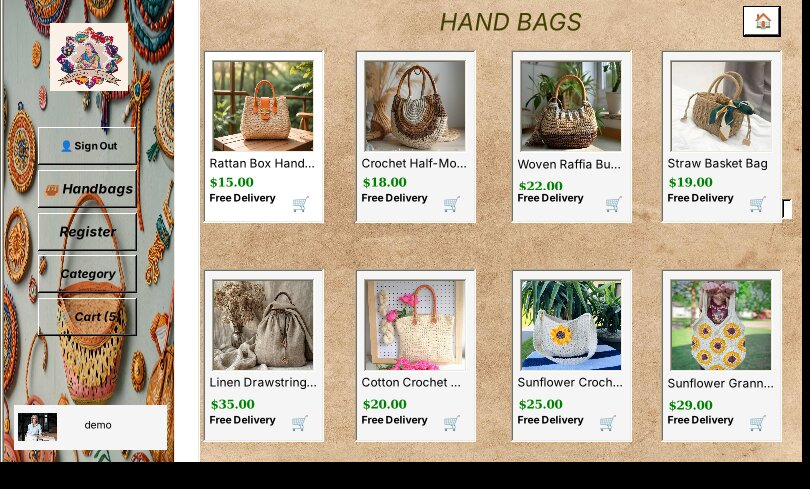
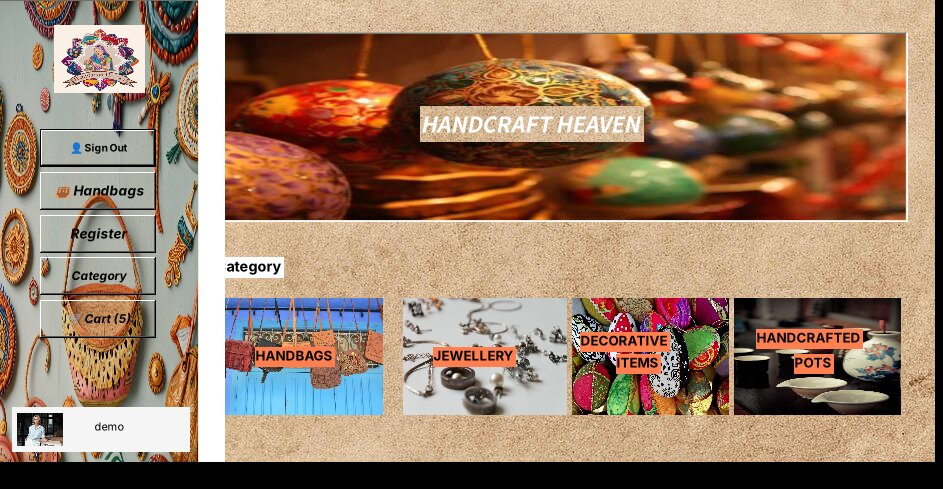
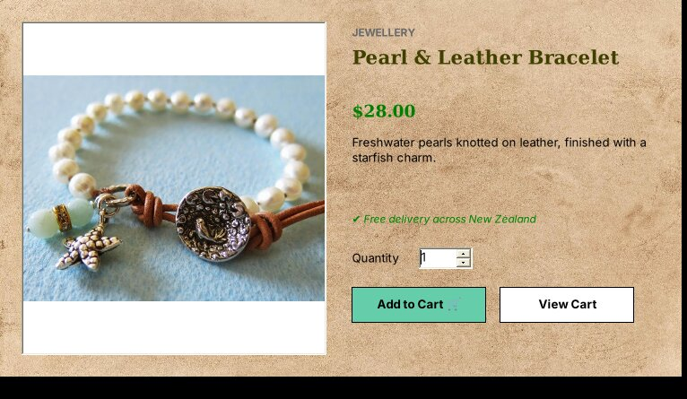
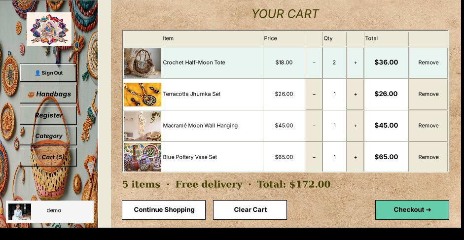

# Handcraft Heaven 🧵

A desktop e-commerce app for handmade goods, built in **C# Windows Forms (.NET Framework 4.7.2)**.
Customers can browse four collections, view product details, manage a shopping cart and place an order.

I first built this in Year 1 of my Bachelor of IT at Otago Polytechnic (Auckland International Campus), then came back to it to finish what the original version left as placeholders: a real product catalogue, a working cart, proper sign-in, and cleaner code.



## Features

- **4 collections, 27 products**: Handbags, Jewellery, Decorative Items and Handcrafted Pots
- **Product pages** with a large photo, description and quantity picker
- **Shopping cart**: add from any card (🛒) or product page, change quantities, remove items, live total in NZD
- **Live cart badge** in the sidebar on every screen
- **Accounts**: sign up with validation, sign in by name or email, or browse as a guest. Checkout requires sign-in and the cart is kept while you do it
- **Secure password storage**: passwords are salted and hashed with PBKDF2 (10,000 iterations), never stored as plain text
- **Rotating hero banner** on the home screen

| Home | Product page | Cart |
|---|---|---|
|  |  |  |

## Try it

1. Open `Form_Loading/Form_Loading.sln` in Visual Studio 2022
2. Press **F5**
3. Sign in with the demo account (**demo** / **demo123**), create your own, or click **Continue as guest**

## How it's built

```
Form_Loading/
├── Models/
│   ├── Product.cs      – a product (name, price, category, image, description)
│   ├── Catalog.cs      – the full range, in one place
│   ├── Cart.cs         – shared cart with a Changed event the UI listens to
│   └── UserStore.cs    – sign-up / sign-in, PBKDF2 password hashing, saved to AppData
├── UI/
│   ├── Nav.cs          – screen navigation + ShopContext (app exits when the last screen closes)
│   ├── ProductCards.cs – binds catalogue products to the designer-built cards
│   └── Theme.cs        – shared colours, fonts and buttons
├── Navigation.cs       – sidebar UserControl used on every screen
├── FormMain.cs         – sign in
├── FormTwo.cs          – create account
├── FormOne.cs          – home
├── FormCategory.cs     – all collections
├── FormThree.cs / FormJewellery.cs / FormDecoration.cs / FormPots.cs – collections
├── FormProductDetail.cs
└── FormCart.cs
```

A few design decisions:

- **One source of truth for products.** The original screens were laid out in the Visual Studio designer with placeholder text. Rather than hand-editing 24 cards, `ProductCards` maps each card to a product ID and fills in the name, price and image at runtime, then wires up the click handlers. The Pots page builds its cards entirely from the catalogue.
- **Event-driven UI.** `Cart.Changed` and `UserStore.CurrentChanged` let the sidebar and cart screen update themselves. The sidebar unsubscribes when its handle is destroyed so closed screens aren't kept alive by static events.
- **Navigation without hidden windows.** The Year 1 version hid the login form and kept it running in the background. `ShopContext` keeps the app alive only while a screen is open, so closing the last window exits cleanly.

## What I'd do next

- Move products and orders into a SQL database instead of code
- Order history page for signed-in customers
- Search and filter within collections
- Unit tests for `Cart` and `UserStore`

## Author

**Satyam Kamboj** · [LinkedIn](https://www.linkedin.com/in/satyam-kamboj-742a79295) · [GitHub](https://github.com/SatyamKamboj10011)

Product photos are used for demonstration only.
