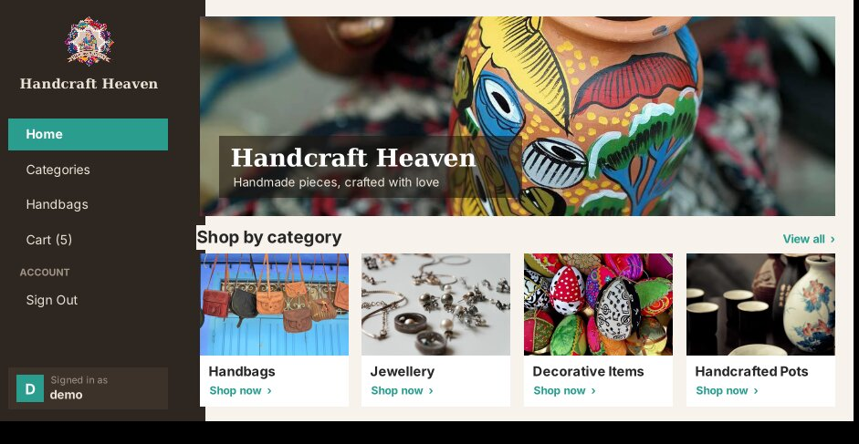
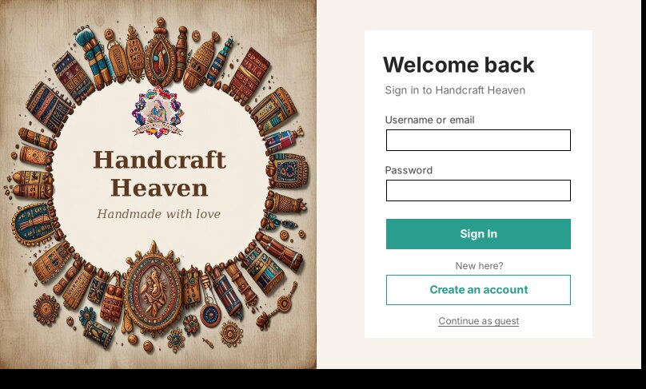
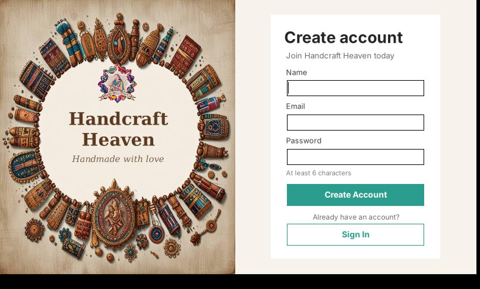
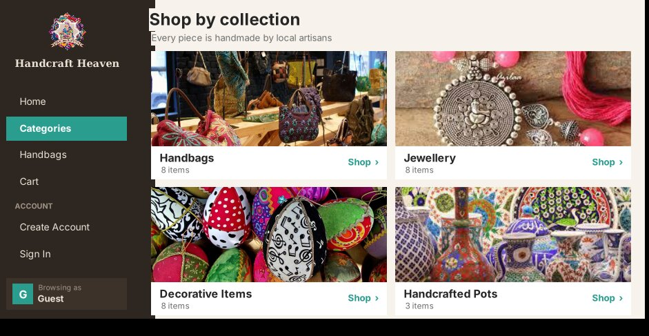
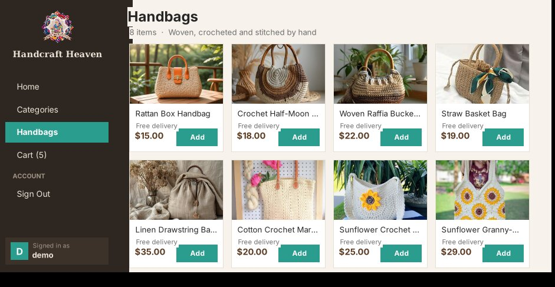
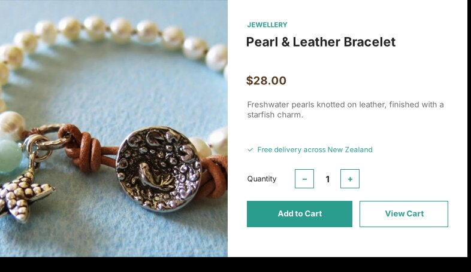
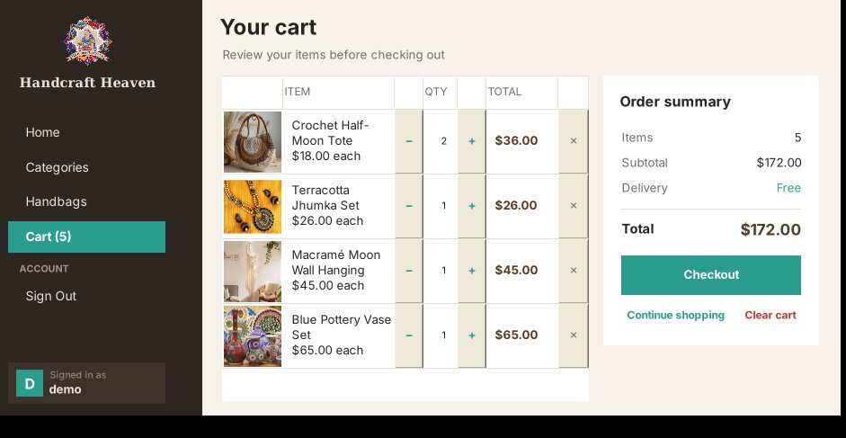

# Handcraft Heaven 🧵

A desktop e-commerce app for handmade goods, built in **C# Windows Forms (.NET Framework 4.7.2)**.
Customers can browse four collections, view product details, manage a shopping cart and place an order.

I first built this in Year 1 of my Bachelor of IT at Otago Polytechnic (Auckland International Campus), then came back to it to finish what the original version left as placeholders and give it a modern redesign: a real product catalogue, a working cart, secure sign-in, a shared design system and cleaner code.



## ⬇️ Download

Grab the latest **HandcraftHeaven-win.zip** from [Releases](../../releases/latest), unzip it, and run `HandcraftHeaven.exe` (Windows 10/11).
Sign in with **demo / demo123**, create an account, or continue as a guest.

> Windows may show a SmartScreen warning because the app isn't code-signed. Click **More info → Run anyway**.

## Features

- **4 collections, 27 products**: Handbags, Jewellery, Decorative Items and Handcrafted Pots
- **Product pages** with an edge-to-edge photo, description and quantity stepper
- **Shopping cart**: add from any card or product page, change quantities, remove items, order summary with live total in NZD
- **Live cart count** and current-page highlight in the sidebar on every screen
- **Accounts**: sign up with validation, sign in by name or email, or browse as a guest. Checkout requires sign-in and the cart is kept while you do it
- **Secure password storage**: passwords are salted and hashed with PBKDF2 (10,000 iterations), never stored as plain text
- **Rotating hero banner** on the home screen

## Screens

| Sign in | Create account |
|---|---|
|  |  |
| **Collections** | **Handbags** |
|  |  |
| **Product page** | **Cart** |
|  |  |

## Run from source

1. Open `Form_Loading/Form_Loading.sln` in Visual Studio 2022
2. Press **F5**

## How it's built

```
Form_Loading/
├── Models/
│   ├── Product.cs      – a product (name, price, category, image, description)
│   ├── Catalog.cs      – the full range, in one place
│   ├── Cart.cs         – shared cart with a Changed event the UI listens to
│   └── UserStore.cs    – sign-up / sign-in, PBKDF2 password hashing, saved to AppData
├── UI/
│   ├── Theme.cs        – design system: palette, type scale, button styles
│   ├── ProductCards.cs – builds product cards and fills collection grids from the catalogue
│   ├── ImageFit.cs     – "cover" image cropping (fill the box without stretching)
│   └── Nav.cs          – screen navigation + ShopContext (app exits when the last screen closes)
├── Navigation.cs       – sidebar UserControl used on every screen
├── FormMain.cs / FormTwo.cs – sign in / create account
├── FormOne.cs          – home
├── FormCategory.cs     – all collections
├── FormThree.cs / FormJewellery.cs / FormDecoration.cs / FormPots.cs – collections
├── FormProductDetail.cs
└── FormCart.cs
```

A few design decisions:

- **One source of truth for products.** Every collection page builds its cards from `Catalog`, so adding a product is one line of code rather than another hand-placed card in the designer.
- **A small design system.** `Theme` holds the colours, fonts and button styles, so screens built in the designer and screens built in code look like one product.
- **Event-driven UI.** `Cart.Changed` and `UserStore.CurrentChanged` let the sidebar and cart update themselves. The sidebar unsubscribes when its handle is destroyed so closed screens aren't kept alive by static events.
- **Layout that survives display scaling.** Product cards are sized from the grid's real width after Windows applies DPI scaling, so it's always four per row.
- **Navigation without hidden windows.** The Year 1 version hid the login form and kept it running in the background. `ShopContext` keeps the app alive only while a screen is open, so closing the last window exits cleanly.

## Build and release

A GitHub Actions workflow (`.github/workflows/build.yml`) builds the app on Windows for every push. Pushing a version tag such as `v2.0.0` publishes a GitHub Release with the ready-to-run zip.

## What I'd do next

- Move products and orders into a SQL database instead of code
- Order history page for signed-in customers
- Search and filter within collections
- Unit tests for `Cart` and `UserStore`

## Author

**Satyam Kamboj** · [LinkedIn](https://www.linkedin.com/in/satyam-kamboj-742a79295) · [GitHub](https://github.com/SatyamKamboj10011)

Product photos are used for demonstration only.
